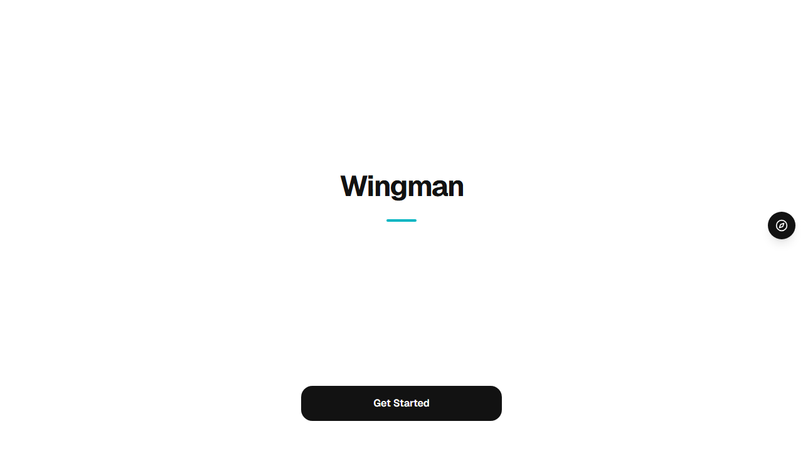
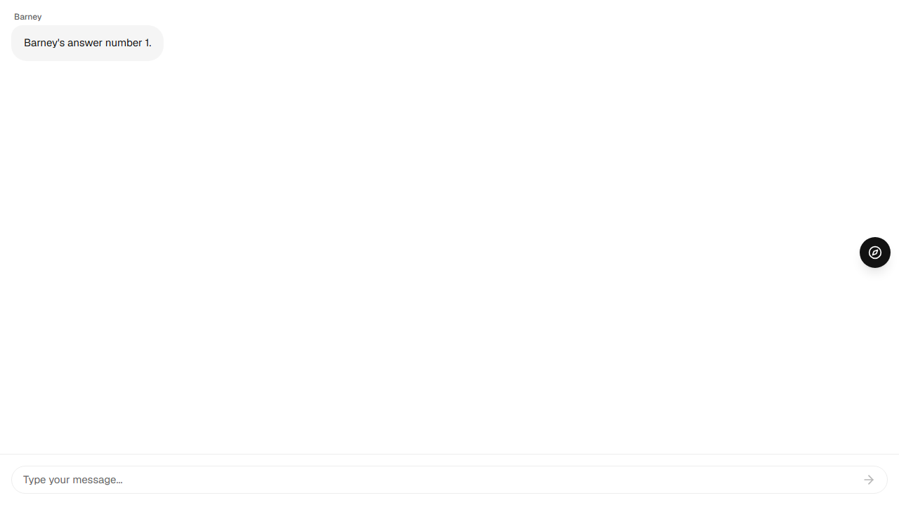
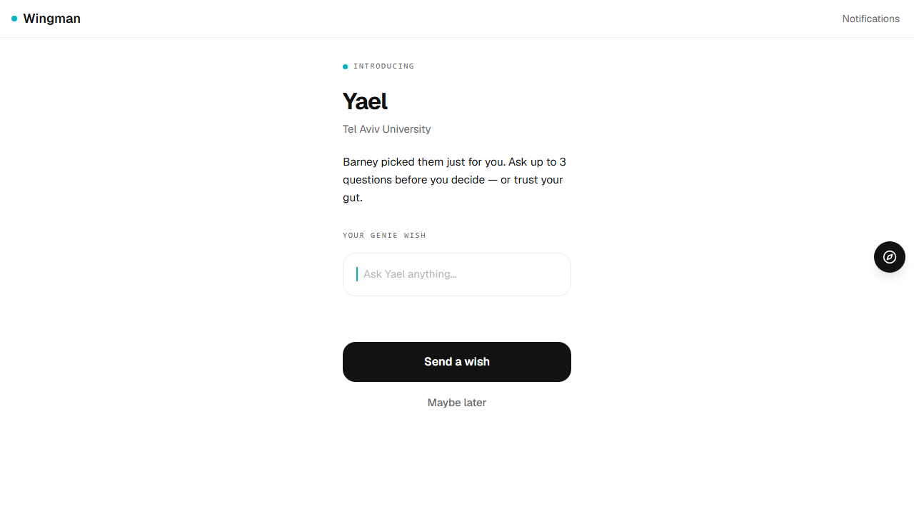
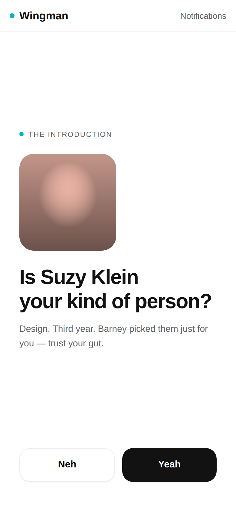
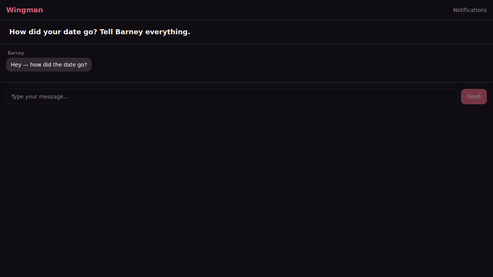
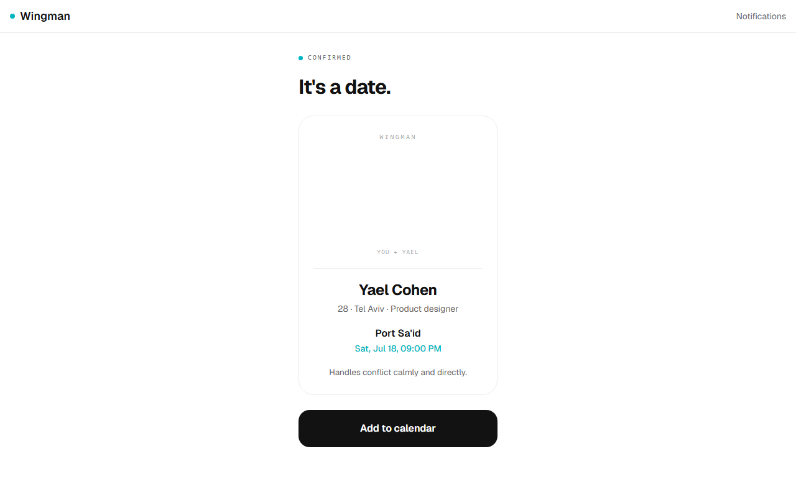
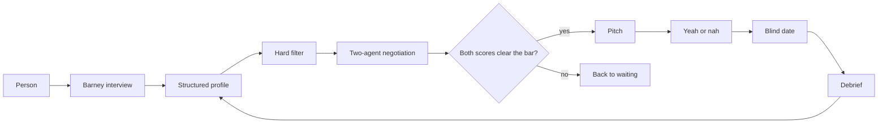

# Wingman

Wingman is a proof-of-concept dating app where people do not browse profiles. An agent named Barney interviews each person, two agents then negotiate a match from the structured profiles, Barney pitches the result, and a debrief after the date feeds back into the profile.

## Screenshots













## Status

This is a proof of concept. It was shelved after market research.

This is a showcase version of a private repository. Agent prompts, matching logic and evaluation data are redacted. The original has ~900 commits and 268 PRs over 3 months.

## How a match happens

1. A person registers with a username and talks to Barney.
2. The interview walks a fixed question graph. Short model calls only judge vague answers and pull out a structured profile.
3. A deterministic filter keeps candidates who pass mutual hard gates: gender preference, age range, and distance. It returns a short list.
4. Two agents, one for each person, exchange a bounded number of turns and each scores the pair. Both scores have to clear a threshold.
5. Barney pitches the match. Each person says yeah or nah, and a yes leads to a blind date.
6. After the date, Barney debriefs and the profile can be updated.



## Tech stack

| Layer          | Choice                                                     |
| -------------- | ---------------------------------------------------------- |
| Monorepo       | pnpm and Turborepo                                         |
| API            | Node.js, TypeScript, Express                               |
| Web            | React, Vite, TypeScript, Tailwind, shadcn/ui               |
| Mobile         | Expo and React Native                                      |
| Eval dashboard | Vite and React                                             |
| Data           | SQLite and Prisma                                          |
| Validation     | Zod, shared by the API and the clients                     |
| Agents         | Anthropic Agent SDK                                        |
| Tests          | Vitest, Jest with React Native Testing Library, Playwright |
| CI             | GitHub Actions                                             |

## Layout

```
apps/api              Express API, interview engine, negotiation loop
apps/web              Dev and audit web client
apps/mobile           Expo app
apps/eval-dashboard   Agent-decision audit dashboard
packages/shared       Zod schemas and client-agnostic logic
packages/database     Prisma schema, SQLite client, seed
docs/adr              Technical design-decision records
docs/screenshots      Product screenshots
```

The apps import database types from `packages/database` and request schemas from `packages/shared`. Route handlers stay thin. Agent SDK calls stay in `apps/api/src/agents`.

## Testing and CI

`pnpm test` runs the Vitest suites and the mobile Jest component tests. Playwright covers full user flows and is not part of the default CI job.

GitHub Actions (`.github/workflows/ci.yml`) checks formatting, lint, types, and `pnpm test` on Node 20. It does not need API keys.

```bash
pnpm install
pnpm db:generate
pnpm format:check
pnpm lint
pnpm typecheck
pnpm test
```

Copy `.env.example` to `.env` and fill in values locally. `DATABASE_URL` can point at a SQLite file. `ANTHROPIC_API_KEY` is only needed when a live model call is actually made.

## How it was built

Wingman was built by Elad Levy and Raz Leshem over about three months. Work landed through pull requests, with technical decisions written down as ADRs in `docs/adr`. Development was AI-assisted: agents drafted code, and the team reviewed it the same way as any other change.

## Team

- [Elad Levy](https://github.com/eladlevy42)
- [Raz Leshem](https://github.com/razleshem1-lab)

## License

MIT. Copyright 2026 Elad Levy. See [LICENSE](LICENSE).
